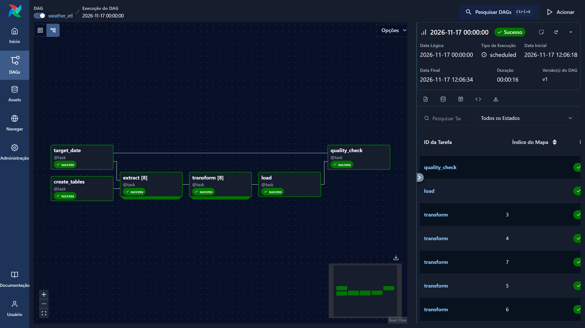
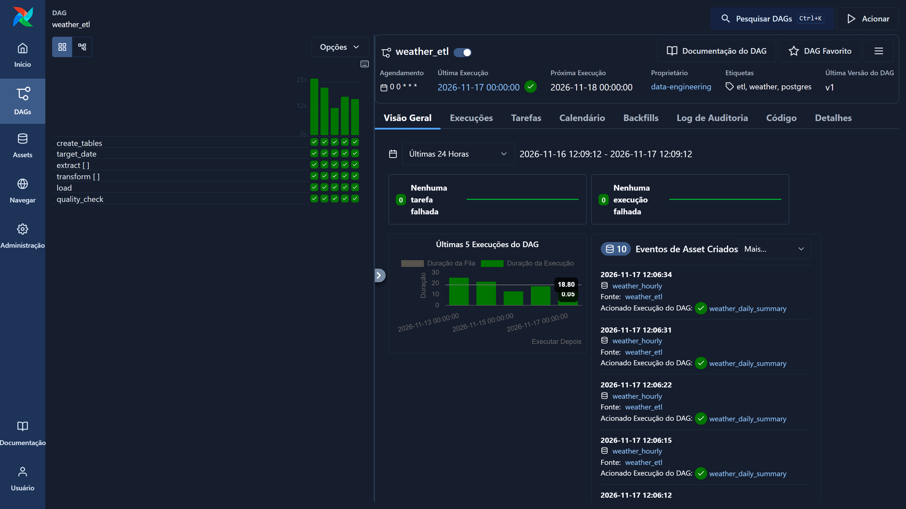
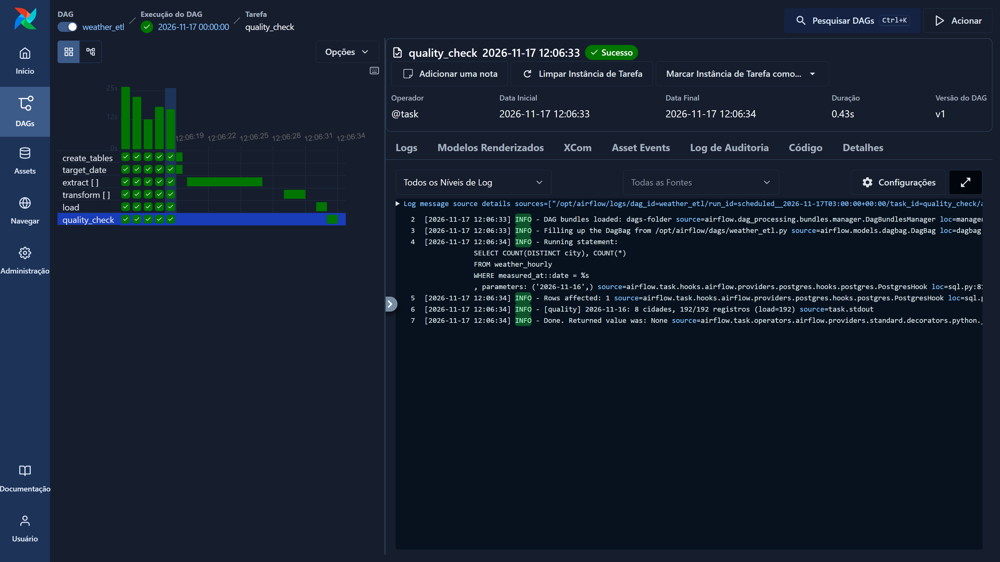
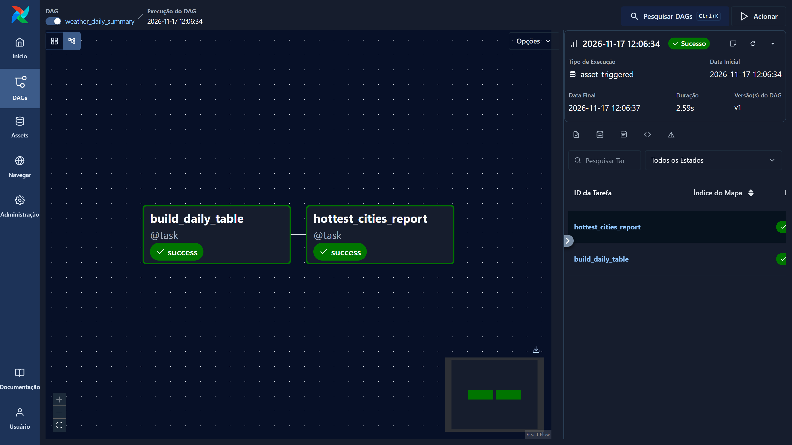
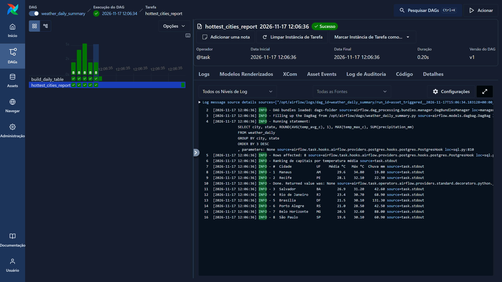

# airflow3-weather-etl

Projeto que fiz para praticar Apache Airflow 3 depois de terminar um curso sobre o assunto. É um ETL simples, mas montado como eu montaria em um ambiente de verdade: pega dados de clima de 8 capitais na API do Open-Meteo, trata e grava num Postgres. Uma segunda DAG roda depois que os dados chegam e gera as agregações diárias.



## DAGs

**weather_etl** (diária, com catchup)

```
create_tables
target_date -> extract (1 por cidade) -> transform (1 por cidade) -> load -> quality_check
```

- `extract` usa dynamic task mapping (`.expand(city=CITIES)`), então cada cidade vira uma task separada e uma falha em uma não derruba as outras.
- Cada execução processa o dia anterior completo, com base na data lógica. Com isso o backfill funciona sem nenhum ajuste.
- O `load` faz upsert (`ON CONFLICT DO UPDATE`), então rodar o mesmo dia duas vezes não duplica nada.
- O `quality_check` confere se chegaram todas as cidades e as 24 horas. Se faltar mais de 5%, a task falha e o asset não é atualizado.

**weather_daily_summary** (disparada pelo asset `weather_hourly`)

Não tem cron. Ela roda quando o `quality_check` da DAG anterior termina com sucesso e atualiza o asset. Recalcula a tabela `weather_daily` (mín, máx e média de temperatura, umidade e chuva por cidade/dia) e imprime um ranking no log.

## Rodando

Precisa de Docker.

```bash
docker compose up -d
```

A UI fica em http://localhost:8081 (sem login, é ambiente local). O Postgres fica exposto na porta 5433, com usuário e senha `airflow` e banco `warehouse`.

As DAGs já sobem ativas e o catchup processa os últimos dias sozinho. Para olhar os dados:

```bash
docker compose exec postgres psql -U airflow -d warehouse -c "select * from weather_daily order by day desc limit 10;"
```

O compose usa `airflow standalone` com LocalExecutor, o que serve para desenvolvimento e não para produção.

## Execução

Backfill de 10 dias, todas as execuções com sucesso:



Log do quality check:



DAG de agregação sendo disparada pelo asset:



Ranking gerado no final:



## Coleta diária no GitHub Actions

Para o repositório não ficar parado, deixei um workflow ([daily-weather.yml](.github/workflows/daily-weather.yml)) que roda todo dia às 6h (horário de Brasília). Ele faz a mesma coleta e agregação, só que sem o Airflow, e salva o resultado em [data/weather_daily.csv](data/weather_daily.csv) e [data/REPORT.md](data/REPORT.md). Dá para rodar manualmente pela aba Actions, passando uma data.

## Estrutura

```
dags/
  weather_etl.py
  weather_daily_summary.py
include/
  cities.py              lista de capitais monitoradas
scripts/
  daily_report.py        coleta usada pelo GitHub Actions
sql/init/                cria o banco warehouse
data/                    dataset atualizado diariamente
docker-compose.yaml      Airflow 3.1 + Postgres 16
```

Dados de clima: [Open-Meteo](https://open-meteo.com/) (CC BY 4.0).
